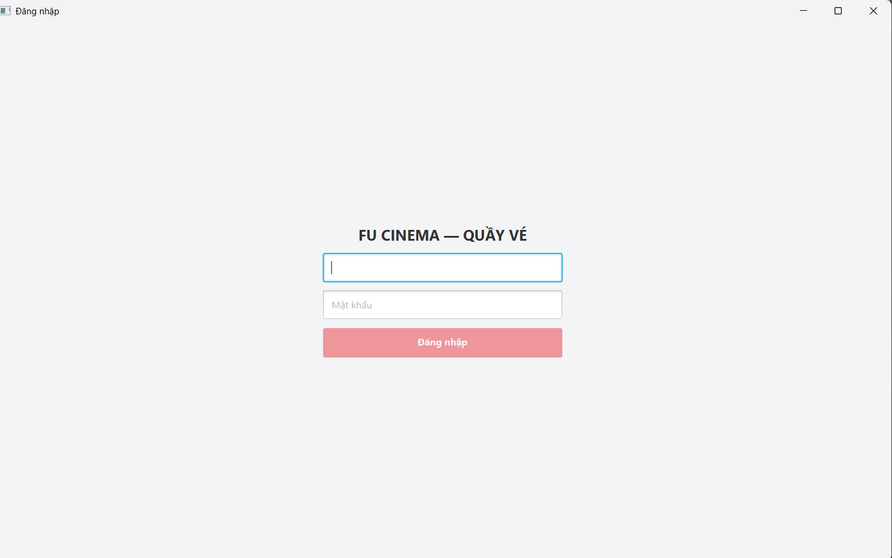
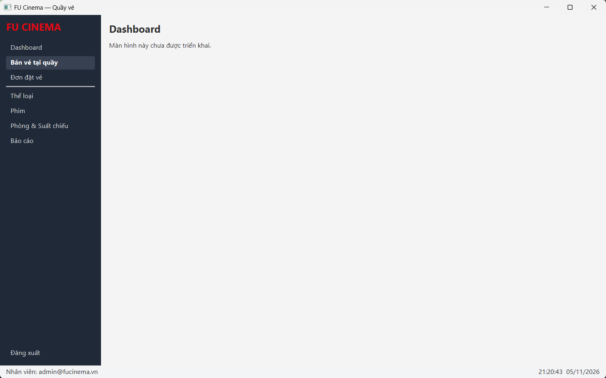
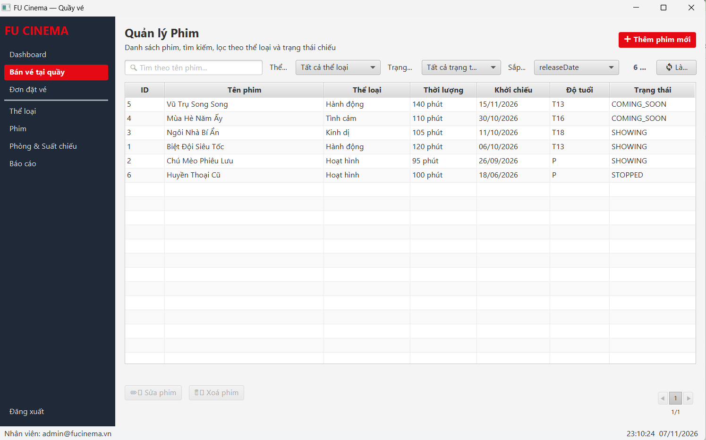
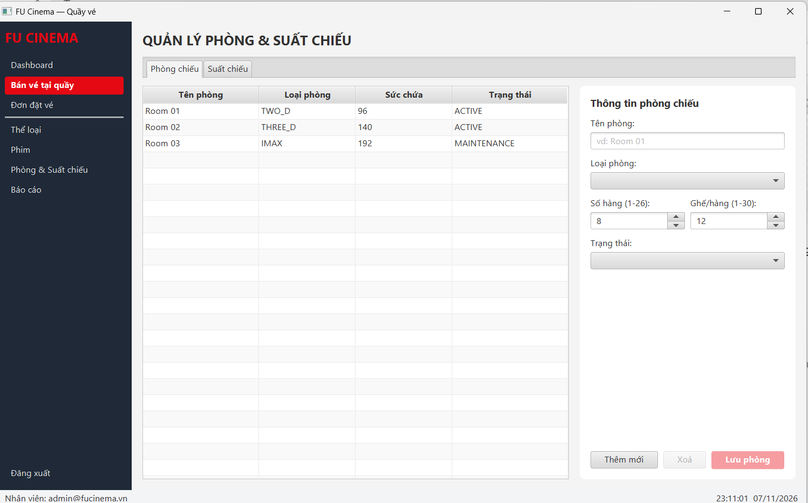
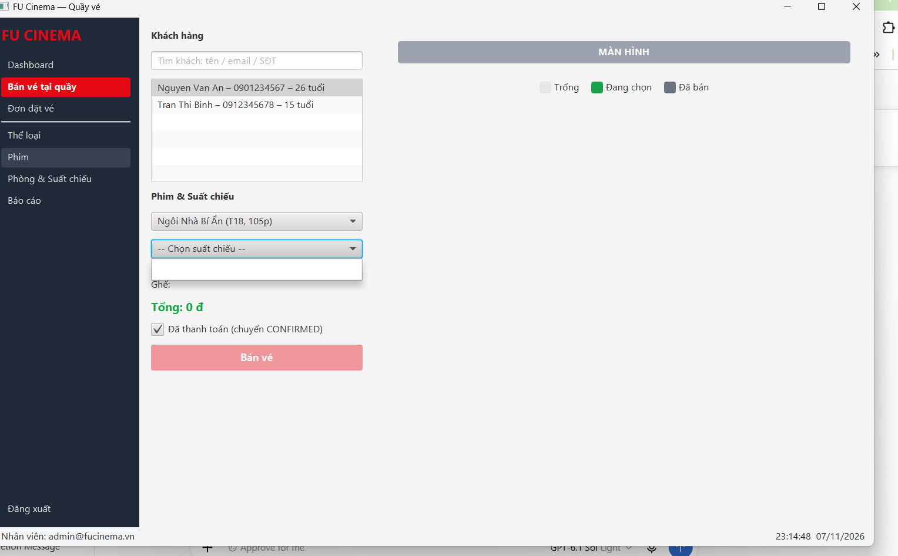
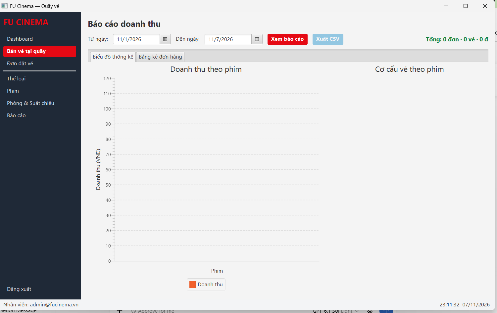

.\mvnw.cmd clean verify
```

Test tích hợp dùng `@SpringBootTest`, `@ActiveProfiles("test")` và H2;
không cần SQL Server cho bộ test này. Không khởi tạo JavaFX Stage/Scene trong
constructor Spring bean để tránh lỗi toolkit khi chạy context test.

Ba trường hợp trong `DesktopFacadeTest`:

1. `adminWithCorrectPassword_canLoginDesktop`.
2. `adminWithWrongPassword_cannotLoginDesktop`.
3. `customerAccount_cannotLoginDesktop`.

**Kết quả build do nhóm cung cấp ngày 07/11/2026 lúc 22:33:03 (UTC+7):**

```text
Tests run: 26, Failures: 0, Errors: 0, Skipped: 0
BUILD SUCCESS
Total time: 53.930 s
```

- Kết quả trên thuộc lần chạy đã cung cấp, không tự xác nhận các commit sau đó.
- Cần bổ sung SHA commit của bản kiểm tra và ảnh/log riêng của `DesktopFacadeTest`.
- 26 test tự động đạt **không đồng nghĩa** mọi kịch bản JavaFX/SQL Server bên dưới đã đạt.

### Ảnh giao diện desktop

Tạo thư mục `docs/images/desktop/` và thêm ít nhất sáu ảnh chạy thật theo tên dưới đây.
Các ô ảnh hiện **chưa được cung cấp trong README đính kèm**; thay bằng ảnh thật
trước khi hoàn tất D14. Không dùng ảnh màn hình tạm để chứng minh module đã hoàn thiện.

| Màn hình | Đường dẫn ảnh cần thêm |
|---|---|
| Đăng nhập | `docs/images/desktop/login.png` |
| Dashboard | `docs/images/desktop/dashboard.png` |
| Quản lý phim | `docs/images/desktop/movie.png` |
| Phòng và suất chiếu | `docs/images/desktop/schedule.png` |
| Bán vé tại quầy | `docs/images/desktop/counter-sale.png` |
| Báo cáo doanh thu | `docs/images/desktop/report.png` |

#### Đăng nhập


#### Dashboard


#### Quản lý phim


#### Phòng và suất chiếu


#### Bán vé tại quầy


#### Báo cáo doanh thu


### Kết quả kiểm thử TC-D01–TC-D20

Chuẩn bị dữ liệu thử nghiệm và chạy web–desktop đồng thời trên SQL Server.
Điền **Pass / Fail / Blocked**, người kiểm tra, ngày và ảnh/log cho từng dòng sau khi chạy.
“Chưa ghi nhận” nghĩa là chưa có kết quả cung cấp, không khẳng định nhóm chưa từng chạy.

| TC | Nội dung / kết quả mong đợi | Trạng thái | Người / ngày / minh chứng |
| TC-D01 | Desktop mở login, không có Tomcat; web vẫn truy cập được | Chưa ghi nhận | Cần bổ sung |
| TC-D02 | ADMIN nhập sai mật khẩu → thông báo sai thông tin | Chưa ghi nhận | Cần bổ sung |
| TC-D03 | CUSTOMER đăng nhập → bị từ chối | Chưa ghi nhận | Cần bổ sung |
| TC-D04 | ADMIN đúng → vào main, status bar có tên; dashboard khớp web | Chưa ghi nhận | Cần bổ sung |
| TC-D05 | Web tạo suất hôm nay → refresh dashboard thấy thay đổi | Chưa ghi nhận | Cần bổ sung |
| TC-D06 | Thêm, sửa, xóa thể loại thử nghiệm → bảng cập nhật | Chưa ghi nhận | Cần bổ sung |
| TC-D07 | Xóa thể loại còn phim → lỗi BR-05, dữ liệu còn nguyên | Chưa ghi nhận | Cần bổ sung |
| TC-D08 | Lọc phim kết hợp và phân trang đúng; đổi lọc về trang đầu | Chưa ghi nhận | Cần bổ sung |
| TC-D09 | Phim 20 phút → dialog không đóng, ô lỗi có thông báo | Chưa ghi nhận | Cần bổ sung |
| TC-D10 | Xóa phim có suất → STOPPED, dòng tô xám | Chưa ghi nhận | Cần bổ sung |
| TC-D11 | Tạo suất trùng phòng/giờ → báo rõ suất xung đột | Chưa ghi nhận | Cần bổ sung |
| TC-D12 | Phim 120 phút, bắt đầu 19:00 → gợi ý kết thúc 21:15 | Chưa ghi nhận | Cần bổ sung |
| TC-D13 | Bán 3 ghế, đã thanh toán → tổng đúng, CONFIRMED, ghế đã bán | Chưa ghi nhận | Cần bổ sung |
| TC-D14 | Chọn ghế thứ 9 → bỏ chọn và cảnh báo tối đa 8 | Chưa ghi nhận | Cần bổ sung |
| TC-D15 | Khách chưa đủ tuổi mua phim T18 → lỗi BR-11 | Chưa ghi nhận | Cần bổ sung |
| TC-D16 | Web và desktop tranh chấp cùng ghế → chỉ một bên thành công, DB không trùng | Chưa ghi nhận | Cần bổ sung |
| TC-D17 | Xác nhận PENDING, hủy CONFIRMED → trạng thái đúng | Chưa ghi nhận | Cần bổ sung |
| TC-D18 | Đơn CANCELLED → nút xác nhận/hủy bị disable | Chưa ghi nhận | Cần bổ sung |
| TC-D19 | Báo cáo khớp web; CSV mở Excel đúng tiếng Việt | Chưa ghi nhận | Cần bổ sung |
| TC-D20 | Đăng xuất về login; đóng desktop kết thúc tiến trình | Chưa ghi nhận | Cần bổ sung |

### Release v2.0.0 — checklist trước phát hành

**Trạng thái trong tài liệu này: chưa xác nhận đã phát hành.**
JAR trong log build được cung cấp vẫn là phiên bản `0.0.1-SNAPSHOT`.
Không ghi release hoàn tất chỉ dựa trên build thành công.

- [ ] Tất cả module desktop đã tích hợp, PR review và merge theo quy trình.
- [ ] TC-D01–TC-D20 có kết quả và minh chứng; xử lý các lỗi còn tồn tại.
- [ ] Có ít nhất 3 test Facade; toàn bộ `clean verify` đạt.
- [ ] README có ít nhất 6 ảnh thật, bảng phân công, URL PR và hướng dẫn chạy đã kiểm tra.
- [ ] Người khác clone repository và chạy được web/desktop theo README.
- [ ] D14 được C và D review.
- [ ] Tạo nhánh `release/v2.0.0` từ develop đã tích hợp.
- [ ] Cập nhật phiên bản `pom.xml` thành `2.0.0`; chạy lại `clean verify`.
- [ ] PR release vào main có 2 approvals và được merge.
- [ ] Tạo tag `v2.0.0` trên đúng commit main đã kiểm tra, tạo GitHub Release có mô tả.
- [ ] Back-merge main về develop.

URL release và SHA kiểm tra: **Cần bổ sung sau khi phát hành**.

### Lỗi desktop thường gặp

| Hiện tượng | Cách kiểm tra |
|---|---|
| IntelliJ reload báo Guice / ArtifactHandlerManager | Kiểm tra Maven importer; trường hợp máy nhóm đã xử lý bằng Bundled Maven 3, importer/runner dùng JDK 21 |
| Không tìm thấy FXML/CSS | Kiểm tra `View.path()`, `/desktop/fxml/`, `/desktop/css/desktop.css` và tài nguyên đã được copy khi build |
| `package ...desktop.util/facade does not exist` | Kiểm tra D2/D3/D4 đã tích hợp vào nhánh hiện tại; fetch không tự merge code |
| File test sai tên / duplicate DesktopFacadeTest | Chỉ giữ một `DesktopFacadeTest.java` trong src/test; không đặt test trong file AuthFacade.java |
| `A bound value cannot be set` | Không để FxAsync thay đổi disable của nút đã bind; khóa form hoặc container phù hợp |
| `Toolkit not initialized` khi test | Không tạo Stage/Scene hoặc gọi UI trong constructor bean; chuẩn bị kiểm thử session phù hợp với quy định FX thread |
| `LazyInitializationException` | Ánh xạ entity → record trong transaction tại Facade, không đưa entity lên controller |
| Giao diện bị treo | Kiểm tra lời gọi Facade chạy qua FxAsync/Task, không truy vấn DB trên FX thread |
| Facade ghi không lưu dữ liệu | Kiểm tra transaction ghi không tham gia transaction read-only; kiểm tra quyền ADMIN |
